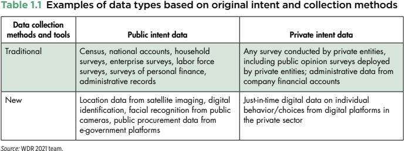
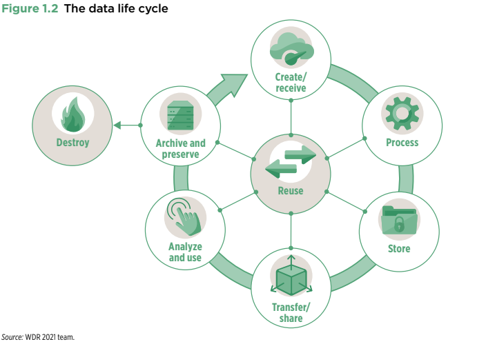
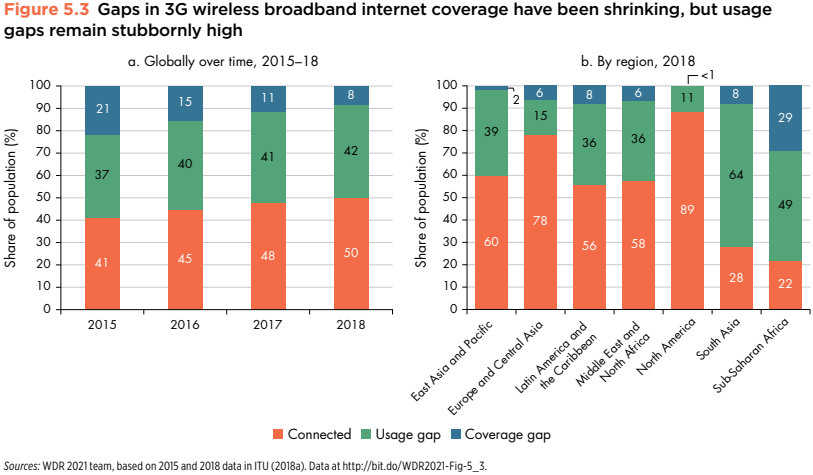

# Benchmark evidence checks

Status: **assistant-proposed, source-verified gold; learner confirmation pending**. A dedicated benchmark-author assistant prepared and checked these cases without inspecting inference code, tuning configurations, running experiments, calling a paid API, or using a model judge. One benchmark author was used. This is not a claim of independent human confirmation.

Source: World Bank. 2021. *World Development Report 2021: Data for Better Lives*. Washington, DC: World Bank. [Original PDF](https://documents1.worldbank.org/curated/en/248201616598597113/pdf/World-Development-Report-2021-Data-for-Better-Lives.pdf). SHA-256: `606c8452c8b23c01d81919c3974972bebeb1e60348a56ea40cc3ae841e301616`. The checked PDF has 350 physical pages. Body printed-page labels equal physical page minus 20 for every benchmark region.

## Split and separation

Dev has exactly 18 cases: 15 answerable (3 each table, image/diagram, chart, multihop, text) and 3 unanswerable. Test has exactly 30: 24 answerable (6 table, 5 image/diagram, 5 chart, 4 multihop, 4 text) and 6 unanswerable. Each case has a single primary group. All seven multihop cases cite at least two distinct physical pages.

The split was authored before experiments. An answer-fact review across the two splits found no paraphrases of the same answer fact. Some distinct questions legitimately share source pages, such as global versus regional panels, or a study's validation method versus a missing causal outcome. Do not choose configurations using Test. Gold files, absence audits, verification manifests and these sample regions are evaluation-only assets and must not enter inference or retrieval selection.

## Direct source checks

The author rendered original PDF pages through PDFium at scale 1.7 (980 x 1286 pixels per page) and visually inspected every cited page, including axes, legends, table headers, units, notes, arrows, and relevant paragraph continuations. The author compared the proposed answer facts to these original page pixels. PDFium native text was a search aid and supplied transcriptions; extracted text alone did not establish visual gold. pypdf was not used for the complex-page text extraction.

Bounding boxes use top-left-origin normalized page coordinates `[x0, y0, x1, y1]`, with increasing y downward. They denote an inspected source region, not a model-generated region. Exact labels, nearby headers, shared legends and notes may be included to preserve interpretation. Where a figure uses shared legends or the text continues across columns, separate evidence entries may point to the same page.

`quote` is a source transcription or a concise transcription combining the named cells/labels within the cited region; semicolons and arrows may join noncontiguous labels. It is not a guarantee of a contiguous verbatim PDF text span. `facts` lists the claims that must be supported, and `units` identifies metric, scale, time frame, or approximation. Arithmetic was checked explicitly: percentage differences use percentage points; the consumption ratio uses displayed rounded values; radar readings are approximate and must not be judged as exact unprinted integers.

The per-case `verification_manifest.json` records inspection status and source-page coverage. It records benchmark provenance, not answer-quality labels from an experiment. Source-page PNGs and individual region crops remain in the local authoring scratch folder `work/advanced-benchmark/`; they are not required by inference.

## Abstention checks

For each unanswerable case, all 350 native page texts were searched after Unicode NFKC normalization, lowercasing, removal of control/soft hyphens, joining line-break hyphens, and whitespace normalization. Search terms include the actual subject and the requested missing condition. The author read relevant matching context and visually checked the nearest subject-specific source pages. `absence_search_audit.json` preserves all search terms, matching physical page lists, normalization and scan count. Each case also states the missing joint condition and method in Vietnamese/English metadata.

These are near-topic omissions (for example, an absent subgroup, operational breakdown, or causal condition), not unrelated invented companies. Nearby aggregate statistics or qualitative recommendations do not satisfy an absent conditioned statistic. Full-text keyword search is not a mathematical proof of absence; hidden/nontextual detail on unrelated pages cannot be categorically excluded. The closely related original figures and paragraphs were inspected to reduce that risk. No external websites or later versions of the report supply missing answers.

## Reproducible visual samples

The following are Dev-only inspected crops from the original source. They illustrate the verification standard without reproducing the full PDF. Re-render the specified physical page and crop the normalized box in `dev.json` to reproduce them.

Attribution for sample crops: World Bank (2021), *World Development Report 2021: Data for Better Lives*, Table 1.1, Figure 1.2, Figure 5.3; cropped from the original pages. The report is [CC BY 3.0 IGO](https://creativecommons.org/licenses/by/3.0/igo/), subject to its copyright-page conditions and third-party component credits. The first two samples are credited to the WDR 2021 team; Figure 5.3 credits WDR team calculations based on ITU data. These samples do not imply separate permission for every third-party image in the report.

## Limitations and grading handoff

This is a benchmark proposal checked by the authoring assistant against source pixels. It has not been confirmed by the learner or another human, and no experiment outcome is pre-labeled. Later grading must inspect each Test response and citation against the original PDF, record a strict pass/fail with reasons, and retain system errors in the denominator. A model judge must not replace that review. Source notes, scope conditions, rounded values and valid alternatives should be considered; a partial answer, wrong unit, unsupported causal claim, or inadequate citation fails under ADVANCED.md.

`freeze.json` pins the exact Dev/Test bytes and source PDF before experimentation. Any intentional later correction requires an explicit versioned audit; do not silently edit frozen gold after examining outcomes.

Cited physical pages inspected: 46, 48, 49, 50, 51, 54, 83, 84, 85, 86, 89, 91, 92, 117, 119, 124, 170, 172, 173, 178, 181, 186, 188, 197, 206, 214, 220, 224, 227, 229, 244, 259, 261, 286, 288, 295, 297, 298, 299, 300, 329, 330, 334, 338.

Additional nearby-topic pages inspected for absence checks: 81, 149, 159, 184, 185, 207, 223, 309, 337.
